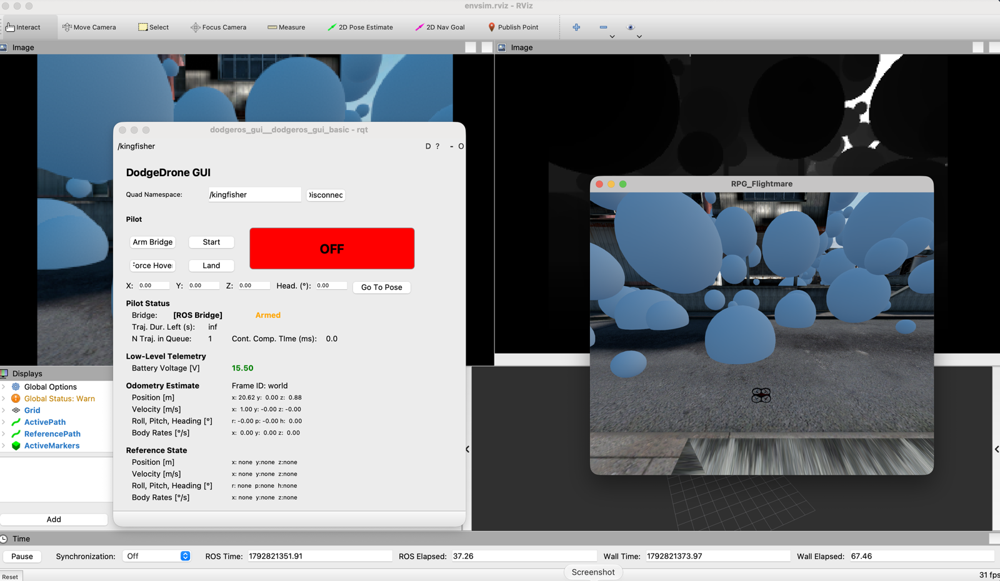
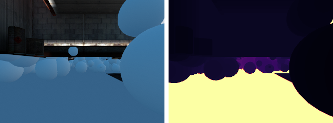
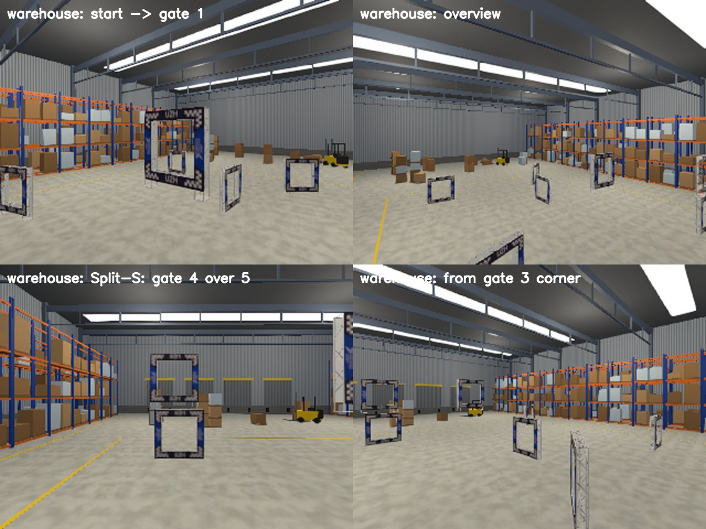
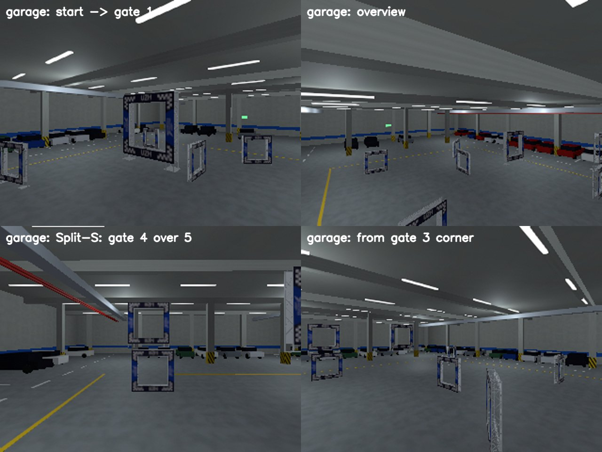
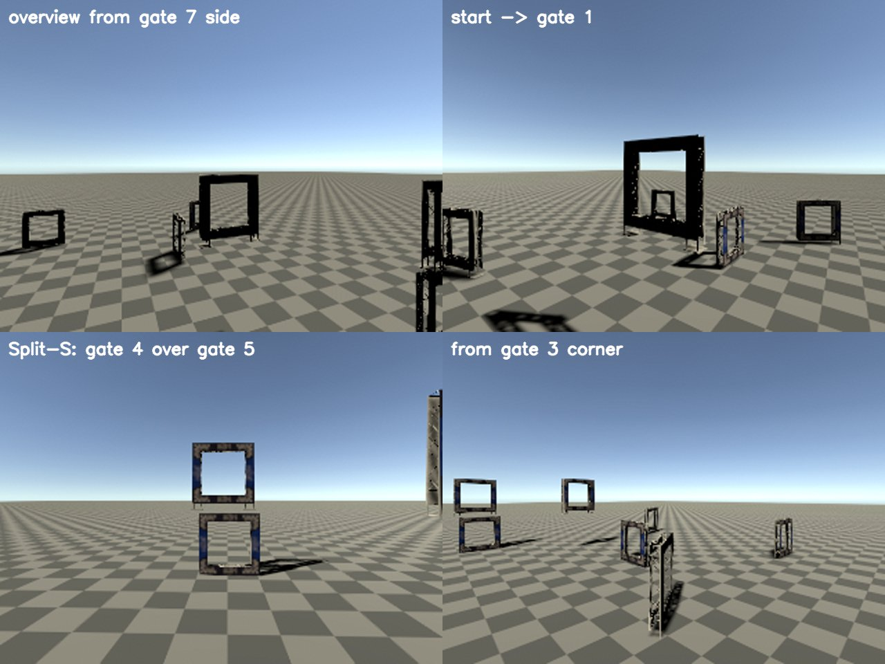

# agile-flight-macos

Run the [DodgeDrone / agile_flight](https://github.com/uzh-rpg/agile_flight) quadrotor simulator (UZH RPG, ICRA 2022) natively on **Apple Silicon macOS**. No VM, Docker or Ubuntu needed.

Upstream only supports Ubuntu 20.04 + ROS Noetic. This repo provides:

- an isolated ROS Noetic environment ([RoboStack](https://robostack.github.io/) via [pixi](https://pixi.sh)) that lives entirely inside this folder,
- small patches that make the upstream code build with clang/libc++ on macOS,
- one-command setup and demo scripts.

Upstream sources are fetched from the public `uzh-rpg` repositories at setup time. Nothing from them is vendored here.



*`pixi run demo --render` on an Apple M4: rviz with the onboard RGB and depth cameras (back), the DodgeDrone pilot GUI (left), and the natively built Flightmare Unity renderer (right). The drone flies through the obstacle field at 1 m/s.*



*Onboard camera frames, 320×240 at 25 Hz: RGB (left) and depth (right).*

## Requirements

- Mac with Apple Silicon (arm64), recent macOS
- Xcode Command Line Tools: `xcode-select --install`
- [pixi](https://pixi.sh): `brew install pixi` (or `curl -fsSL https://pixi.sh/install.sh | sh`)
- About 7 GB of disk space (ROS desktop-full + PyTorch)

## Quick start

```bash
git clone <this-repo-url> agile-flight-macos
cd agile-flight-macos
pixi run setup     # installs env, clones uzh-rpg/agile_flight, patches, builds (~5 min)
pixi run demo      # simulator + rqt pilot GUI + rviz, takes off and flies forward
```

`pixi run demo --headless` runs without any windows. Press Ctrl-C to stop.

The demo flies the example policy in `src/agile_flight/envtest/ros/user_code.py`, a constant 1 m/s forward command. Edit that file to plug in your own controller.

## Manual usage (upstream workflow)

Open a shell in the environment with `pixi shell`, then run `source devel/setup.bash` in each terminal:

```bash
# Terminal 1: simulator (+ GUI, rviz)
cd src/agile_flight/envtest
roslaunch envsim visionenv_sim.launch render:=False
# In the GUI: press "Arm Bridge", then "Start" to take off.

# Terminal 2: evaluation
cd src/agile_flight/envtest/ros && python evaluation_node.py

# Terminal 3: your policy
cd src/agile_flight/envtest/ros && python run_competition.py

# Terminal 4: go
rostopic pub /kingfisher/start_navigation std_msgs/Empty "{}" -1
```

Rebuild after code changes with `pixi run build` (or `catkin build` inside `pixi shell`).

## What works

| Component | Status |
|---|---|
| ROS Noetic core, rviz, rqt, Gazebo 11 (headless and GUI) | ✅ |
| DodgeDrone simulator (`envsim`), physics, obstacles, controllers | ✅ |
| rqt pilot GUI (Arm / Start / Land) | ✅ |
| Competition stack: `evaluation_node.py`, `run_competition.py`, state-based policies | ✅ |
| Camera images (RGB / depth), vision-based mode | ✅ after building the Unity renderer (below) |
| Python RL env `flightgym` (`VisionEnv_v1`), `rpg_baselines` PPO training and evaluation | ✅ (below) |
| ACMPC training (differentiable MPC actor) and flying the policy in the ROS sim | ✅ (below) |
| Gate racing (paper task): AC-MPC / AC-MLP training (Colab), evaluation, racing in the ROS sim with gates in rviz and Unity (Industrial, warehouse, garage, arena) | ✅ (below) |
| Gate racing with FlashSAC (off-policy SAC) on the same task: training (Colab), evaluation, racing in the ROS sim | ✅ (below) |
| Environments other than Industrial | ❌ not in the public Unity project; generated warehouse, garage and arena scenes instead (below) |
| BEM propeller model (`use_bem_propeller_model:=True`) | ❌ no-op upstream: `visionsim_node` always uses `ModelThrustTorqueSimple`, and the public dodgelib has no BEM model |
| NVIDIA CUDA | ❌ PyTorch runs on CPU / MPS |

## Camera images (Unity renderer)

Images come from the Flightmare Unity standalone, which upstream only ships for Linux x86_64. `pixi run build-renderer` builds a native Apple Silicon (Metal) version from the public source, [uzh-rpg/flightmare_unity](https://github.com/uzh-rpg/flightmare_unity), branch `dev/agile_flight`.

1. Install Unity Hub (`brew install --cask unity-hub`) and Unity Editor **2021.3.45f2** (Apple silicon). Either use the Hub UI, or run:
   ```bash
   "/Applications/Unity Hub.app/Contents/MacOS/Unity Hub" -- --headless install \
     --version 2021.3.45f2 --changeset 88f88f591b2e --architecture arm64
   ```
2. Open Unity Hub, sign in, and add a license (Preferences → Licenses → Add → free Personal license).
3. Build and install the renderer. The first build imports all assets and takes a while:
   ```bash
   pixi run build-renderer
   ```
4. Run with images:
   ```bash
   pixi run demo --render
   ```
   The images appear on `/kingfisher/dodgeros_pilot/unity/image` and `.../unity/depth` (320×240, 25 Hz) and in rviz.

Notes:

- **Only the Industrial ("street") environment is public.** The Warehouse, Forest and Wasteland scenes use commercial assets that UZH keeps out of the public repo. The macOS patch therefore sets `scene_id: 1` in `flightmare/flightpy/configs/vision/config.yaml`. If you have the full asset set, put your project at `FLIGHTMARE_UNITY_PROJECT=/path/to/project`, rebuild, and change `scene_id` back.
- The renderer is built with 2021.3 LTS instead of the project's original 2021.2. The build script adds `com.unity.nuget.newtonsoft-json`, which the 2021.3 package upgrade otherwise drops.
- The Unity player log is at `~/Library/Logs/Robotics and Perception Group/RPG_Flightmare/Player.log`.

## Python RL environment (flightgym)

`pixi run setup` also builds flightlib's Python binding, `flightgym`, into `build_flightgym/`. The environment puts it and `rpg_baselines` on `PYTHONPATH`, so no `pip install` is needed. Rebuild after C++ changes with `pixi run build-flightgym`.

```bash
pixi shell
cd src/agile_flight/envtest
python -m python.run_vision_ppo --train 1                      # PPO, 100 envs, logs to python/saved/PPO_<n>
python -m python.run_vision_ppo --train 0 --trial 1 --iter 50  # evaluate a checkpoint
python -m python.run_vision_demo --render 1                    # random actions + Unity RGB/depth (needs build-renderer)
```

On an M4 (CPU only), PPO training runs at about 7,600 environment steps per second. Upstream's Python code targets gym 0.21, stable-baselines3 1.x, numpy 1.x and an older ruamel.yaml. The patches port it to gymnasium, stable-baselines3 2.x, numpy 2 and ruamel.yaml 0.19 (see the table below).

## ACMPC (Actor-Critic MPC)

[ACMPC](https://github.com/uzh-rpg/acmpc_public) (Romero et al., T-RO 2025) puts a differentiable MPC ([mpc.pytorch](https://github.com/locuslab/mpc.pytorch)) inside the PPO actor: an MLP predicts the MPC cost, and the MPC's first collective-thrust + body-rate (CTBR) command is the action. [`acmpc/`](acmpc/) trains it on flightgym's `VisionEnv_v1` and flies it in the ROS simulator.

```bash
pixi run setup-acmpc      # clones uzh-rpg/acmpc_public + mpc.pytorch into src/acmpc_public
                          # (or: export ACMPC_PATH=/path/to/your/acmpc_public first)
pixi run train-acmpc      # ACMPC, MPC horizon 5; logs to acmpc/saved/MPC_<n>
pixi run train-acmpc --policy mlp   # model-free baseline with ACMPC's network sizes
```

Fly a checkpoint in the ROS simulator with CTBR commands. This replaces `run_competition.py` in the manual workflow above:

```bash
# Terminal 1 and 2: simulator and evaluation_node.py, as above
# Terminal 3:
python acmpc/run_acmpc_ros.py --run acmpc/saved/MPC_1 --iter 500
# Terminal 4: GUI "Arm Bridge" + "Start", then
rostopic pub /kingfisher/start_navigation std_msgs/Empty "{}" -1
```

How it fits together:

- **No stable-baselines3 fork.** ACMPC ships a stable-baselines3 1.7 fork (it pins gym 0.21, which doesn't install on Python 3.12). The fork passes a 13-dim drone state `[p, q, v, w]` next to the observation through the policy, rollout buffer and PPO, and uses the MPC output directly as the Gaussian mean (`distr_identity`). [`acmpc_policy.py`](acmpc/acmpc_policy.py) does the same on stock stable-baselines3 2.x: [`acmpc_env.py`](acmpc/acmpc_env.py) appends the raw drone state to the observation, and the policy splits it off again. The upstream `CustomNetwork` / `CustomNetworkMlp` are used unchanged, and the fork's submodule is not needed.
- **Task.** The paper's racing environment is not public. Training uses DodgeDrone's obstacle-avoidance task (state-based: goal velocity, attitude, velocity, 10 nearest obstacles). `VisionEnv_v1` already takes CTBR actions, normalized the same way as ACMPC's MPC output.
- **Matching dynamics.** `acmpc_config()` sets the env's body-rate limits to `[10, 10, 4]` rad/s and the max thrust to 8.5 N per rotor. These are the limits of ACMPC's MPC model (`drone.py`) and of the ROS simulator's `kingfisher.yaml`. flightlib's default derives 12.25 N per rotor from `motor_omega_max`, so without this the MPC's thrust commands would be scaled wrong.
- **Speed.** On an M4 (CPU), one MPC solve for 100 environments takes about 8 ms forward and 6 ms backward. mpc.pytorch prints `pnqp warning: Did not converge` because ACMPC runs one LQR iteration per step, as upstream does.
- `patches/acmpc_public.patch` replaces the `DRONE_PATH` placeholder and imports `gymnasium` instead of `gym`.

## Gate racing: AC-MPC vs AC-MLP (the paper's task)

The ACMPC paper evaluates on **drone racing through gates**: fly a fixed track (Split-S: 7 gates, two of them stacked, so the drone dives through the upper gate, loops, and comes back through the lower one) as fast as possible without crashing. It compares two actors trained with the same PPO setup:

- **AC-MLP**: standard PPO, an MLP outputs the CTBR command directly.
- **AC-MPC**: an MLP outputs the cost of a differentiable MPC (horizon 5, quadrotor model inside), and the MPC's first command is the action.

The paper's claims: AC-MPC learns from less exploration, reaches the same lap times, and handles out-of-distribution conditions better (wind, mass and body-rate-limit changes, other start positions, a different simulator). Upstream released the networks and the MPC, but not the racing environment. [`acmpc/race_env.py`](acmpc/race_env.py) rebuilds it from the paper (Sec. IV-A):

| | |
|---|---|
| Observation | velocity, rotation matrix, relative corners of the next gate, corner offsets to the gate after it (36), plus the raw drone state for the MPC |
| Action | collective thrust + body rates, limits of ACMPC's MPC model and `kingfisher.yaml` |
| Reward | progress towards the next gate center − 0.01·‖ω‖; +10 gate passed; +10 race finished; −10 crash (gate frame, ground, leaving the arena) |
| Tracks | [`acmpc/tracks/`](acmpc/tracks/): `splits` (upstream `envsim/parameters/tracks/SplitS.yaml`), `circle`; any file in that format works |
| PPO | paper Table II: γ 0.98, λ 0.95, 250 steps × 100 envs, 10 epochs, lr 3e-4 → 1e-5, log-std −1.2 (AC-MPC) / −0.5 (AC-MLP) |

The environment is plain numpy (no flightgym, no ROS), so it trains on Colab. The training simulator adds thrust and body-rate lag to the MPC's model, so the MPC never has the exact dynamics. Gates are 1.5 m square openings with a 0.3 m frame.

**1. Train on Colab.** Open [`acmpc/colab_train_race.ipynb`](acmpc/colab_train_race.ipynb) (in VS Code with the Colab extension: Select Kernel → Colab → GPU), Run All. It trains both policies in parallel, saves to Google Drive when it can, resumes after a disconnect, and packages `race_runs.zip`. Unzip that into `acmpc/saved/race/`. Locally the same is `python acmpc/train_race.py --policy mpc|mlp --track splits [--resume RUN]`; AC-MPC takes ~27 s per iteration on an M4 CPU, so use a GPU.

**2. Compare in the training simulator** (64 starts spread over a 0.5 m cube, as in the paper):

```bash
pixi run eval-race acmpc/saved/race/MPC_splits_1 acmpc/saved/race/MLP_splits_1 --plot race.png
pixi run eval-race RUN_MPC RUN_MLP --sweep mass_scale 0.8 1.0 1.2 1.4     # paper Fig. 7
pixi run eval-race RUN_MPC RUN_MLP --sweep omega_max_scale 1.0 0.8 0.6   # body-rate limit
pixi run eval-race RUN_MPC RUN_MLP --wind 0 0 -5                         # constant force [N]
pixi run eval-race RUN_MPC RUN_MLP --track circle                        # unseen track
```

It prints success rate, crash rate, gates passed, lap time and speeds, and `--plot` draws top and 3D views of all runs with the gates.

**3. Race in the ROS simulator.** dodgeros has a rotor-level model and its own low-level controller, so this is a sim-to-sim transfer test, like the paper's evaluation in a higher-fidelity simulator:

```bash
pixi run race-sim --run acmpc/saved/race/MPC_splits_1                     # rviz: gates + flown path
pixi run race-sim --run acmpc/saved/race/MPC_splits_1 --render            # + Unity, Industrial scene
pixi run race-sim --run acmpc/saved/race/MPC_splits_1 --render --scene warehouse --trials 5
```

The script takes off, flies to the track start, races (`acmpc/run_race_ros.py`, 50 Hz CTBR), and prints gates, lap times and speeds per trial. With `--render` the gates appear in Unity (the UZH gate model, `gate_default` prefab). Unity scenery is visual only: the ROS sim has no collisions with it, and the state-based policies never see images.

Scenes for `--scene`:

| Scene | Unity id | Contents |
|---|---|---|
| `industrial` (default) | 1 | upstream Industrial scene; the track is moved 20 m along x into the open yard of the DodgeDrone corridor |
| `warehouse` | 0 | 56 × 40 × 12 m steel hall: pallet racks, crates, forklifts, loading dock, skylights |
| `garage` | 2 | 56 × 40 × 7 m concrete parking garage: columns, parked cars, fluorescent lights, ducts |
| `arena` | 4 | empty 300 m checkered ground |

Upstream's Warehouse, Forest, Mountain, Wasteland and other scenes use commercial assets and only exist as Linux builds, so they can't run on macOS. Instead, [`renderer/RaceScenes.cs`](renderer/RaceScenes.cs) generates the warehouse, garage and arena from Unity primitives and procedural textures (no third-party assets) during `pixi run build-renderer`. The halls are centered on the bundled tracks and keep the track volume clear. flightlib only accepts scene ids below 5, so they take the ids of the non-public upstream Warehouse (0) and Mountain (2) scenes.



*`--scene warehouse`: onboard camera views of the Split-S track.*



*`--scene garage`.*



*`--scene arena`.*

## Gate racing with FlashSAC

[`flashsac/`](flashsac/) trains [FlashSAC](https://github.com/Holiday-Robot/FlashSAC) (Kim et al., arXiv 2604.04539: off-policy SAC with large batches, few updates and bounded norms) on the same racing MDP as the PPO runs (`acmpc/race_env.py`, dodgeros dynamics, 50M env steps). Differences to the PPO setup, all needed for off-policy learning: a fixed observation normalization (so replay-buffer transitions keep their meaning), an asymmetric critic that also sees the full drone state, rotor speeds, command delay and last commands, and timeouts as truncations. Hyperparameters are FlashSAC's GPU-simulator settings (paper Table 9) with PPO's γ = 0.98.

```bash
pixi run setup-flashsac     # clones Holiday-Robot/FlashSAC into src/FlashSAC (or: export FLASHSAC_PATH=...)
pixi run train-flashsac     # logs to acmpc/saved/race/SAC_splits_dodgeros_<n>; use a GPU
```

**Train on Colab:** [`flashsac/colab_flashsac_race.ipynb`](flashsac/colab_flashsac_race.ipynb) (Run All on a T4, ~45 min per seed) trains several seeds, saves to Google Drive when it can, resumes after a disconnect, and packages `flashsac_runs.zip`. Unzip that into `acmpc/saved/race/`.

FlashSAC runs work wherever PPO runs do, as `RUN_DIR`, `RUN_DIR:ENV_STEPS` or `RUN_DIR:best` (the checkpoint with the best training-time evaluation; the deterministic policy can collapse between checkpoints, so the latest is not always the best):

```bash
pixi run eval-race acmpc/saved/race/SAC_splits_dodgeros_1:best acmpc/saved/race/MLP_splits_1 --plot race.png
pixi run race-sim --run acmpc/saved/race/SAC_splits_dodgeros_1:best --render
pixi run python flashsac/compare.py "FlashSAC=RUN_SAC" "PPO=RUN_MLP"        # learning curves, steps / time to a success rate
pixi run python flashsac/benchmark.py "FlashSAC=RUN_SAC:best" "AC-MLP=RUN_MLP"  # mass, drag, delay, wind, random starts
```

First results on Split-S (one seed each, 64 starts): FlashSAC reaches 100% success with a 5.07 s lap (AC-MLP: 100%, 5.08 s). It needs about as many env steps as PPO AC-MLP (50% success at 13.4M vs 10.6M steps) but less wall-clock time (15 vs 19 min to 50%, 20 vs 28 min to 80%; FlashSAC on a Colab T4, PPO on a Kaggle GPU).

## What the setup changes

All changes are in [`patches/`](patches/), [`scripts/`](scripts/) and [`pixi.toml`](pixi.toml):

| Problem on macOS | Fix |
|---|---|
| RoboStack `librospack.dylib` uses CPython symbols without linking libpython, so rviz, Gazebo ROS plugins and every C++ node abort with `symbol not found in flat namespace '__Py_NoneStruct'` | [`scripts/fix_rospack.py`](scripts/fix_rospack.py) adds the missing `libpython` load command (task `pixi run fix-macos`; it runs during setup) |
| CMake 4 rejects `cmake_minimum_required(VERSION <3.5)` | `-DCMAKE_POLICY_VERSION_MINIMUM=3.5` |
| `empy` 4 breaks ROS message generation (`em.RAW_OPT`) | pin `empy==3.3.4` |
| flightlib's bundled nlohmann/json 2.1.1 fails with libc++ (`std::vector<bool>`) | header shim to nlohmann/json 3.x (same JSON on the wire) |
| `std::string` passed to printf-style `%s` logger, which clang rejects because it aborts at runtime | `.c_str()` in flightlib (real bug, also on Linux) |
| `-Werror` plus newer clang warnings inside Eigen and generated headers | `-Wno-error` for clang in flightlib and dodgeros |
| flightlib downloads its own Eigen | `-DEIGEN_FROM_SYSTEM=ON` |
| Gazebo multicast fails, and the online model DB is gone | `GAZEBO_IP`/`IGN_IP=127.0.0.1`, empty `GAZEBO_MODEL_DATABASE_URI` |
| `FLIGHTMARE_PATH` unset, so the node segfaults | exported by [`activate.sh`](activate.sh) |
| Submodule URLs use SSH | rewritten to HTTPS during setup |
| Obstacle layouts (`static_obstacles.csv`) are a separate download | fetched by setup from UZH (~600 MB; skip with `SKIP_OBSTACLES=1`) |
| Unity renderer only released for Linux | built from source for macOS arm64 (`pixi run build-renderer`) |
| flightlib downloads pybind11 `master` in a nested CMake project that CMake 4 rejects | use the env's pybind11 3.x (`find_package(pybind11)`) |
| `rpg_baselines` imports `gym` and removed numpy aliases (`np.Inf`, `np.bool`) | `gymnasium`, `np.inf`, `bool` |
| `rpg_baselines` uses the stable-baselines3 1.x `BaseAlgorithm` API (`policy_base`, `create_eval_env`, old `_setup_learn`, `start_time` in seconds) | ported to stable-baselines3 2.x |
| `ruamel.yaml` 0.18+ removed `dump()`, which the envtest scripts use | small `dump()` helper on the `YAML()` API |
| torch 2.6+ refuses to load SB3 policy checkpoints (`weights_only=True`) | `weights_only=False` in `run_vision_ppo.py`; only load checkpoints you trust |
| Unity's obstacle CSV loader skips the first row and copies quaternion and scale without the ROS→Unity conversion; the gate prefabs carry non-kinematic Rigidbodies, so gates fall or get knocked away by the drone model | the race overlay writes a dummy first row and Unity-frame rotation and scale ([`race_track.py`](acmpc/race_track.py)); `build-renderer` makes the gate prefabs kinematic |
| Only Industrial is public; the other Flightmare scenes are commercial and Linux-only | `RaceScenes.cs` generates a warehouse (id 0), garage (id 2) and arena (id 4) during `build-renderer`; flightlib rejects ids ≥ 5 |

## Troubleshooting

- **`symbol not found in flat namespace '__Py_NoneStruct'`**: run `pixi run fix-macos`. Re-run it after anything that reinstalls the environment (`pixi install`, `pixi add`, `pixi update`).
- **"No valid state estimate, will not start!"**: you pressed Start too early. Wait a few seconds after launch and press it again.
- **First `--render` run is slow**: the first launch of the freshly built app can take over a minute (macOS checks the new app, and Unity compiles Metal shaders). If the drone doesn't take off, stop with Ctrl-C and run the demo again.
- **`Unity Connection time out!` / empty images**: run `pixi run build-renderer` first. If it still fails, check `Player.log` (see above). A missing `static_obstacles.csv` makes the renderer error out, so re-run setup without `SKIP_OBSTACLES`.
- **Port 11311 already in use**: a previous `roscore` is still running. Stop it with `pkill -f rosmaster`.
- **Start over**: `rm -rf build build_flightgym devel logs .catkin_tools` and run `pixi run setup` again. Delete `.pixi` too for a completely fresh environment.

## Caveats

ROS Noetic (EOL May 2025) and Gazebo Classic (EOL January 2025) no longer receive updates, and RoboStack no longer rebuilds Noetic packages. `pixi.lock` pins a known-good set.

## Credits

- [agile_flight](https://github.com/uzh-rpg/agile_flight), [flightmare](https://github.com/uzh-rpg/flightmare) and [dodgedrone_simulation](https://github.com/uzh-rpg/dodgedrone_simulation): Robotics and Perception Group, University of Zurich. Upstream code is under its own licenses.
- [acmpc_public](https://github.com/uzh-rpg/acmpc_public): Robotics and Perception Group, University of Zurich. [mpc.pytorch](https://github.com/locuslab/mpc.pytorch): Brandon Amos et al.
- [RoboStack](https://robostack.github.io/) for ROS on conda-forge.

The scripts and patches in this repository are MIT licensed (see [LICENSE](LICENSE)).
